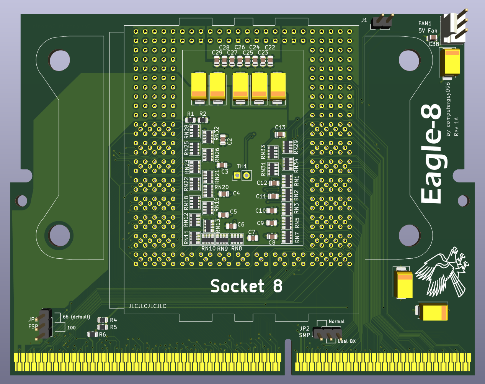

# Eagle-8: Pentium Pro for affordable boards

This is a Socket 8 to Slot 1 adapter (so called "slotket") which allows you to install Pentium Pro CPUs in Slot 1 motherboards. This project was mainly started because of the Socket 8 boards scarcity and limitations (no AGP bus, limited to EDO memory, etc) and being tired of having to deal with them. 

Features:
- AM3 bracket holes + 3D printed spacer (modern AM3 CPUs sit lower than the Pentium Pro, so it has to be adapted)
- spot for an optional NTC thermistor located right under the CPU package; it is connected to the J3 header at the top
- spot for an optional 3-pin fan header, fed from the +5V pin in the Slot 1 connector
- FSB jumper with the option to run the slotket at 100MHz bus speed
- BR1<->BR3 selection jumper, to allow dual CPU operation in 440BX boards

There is an interactive HTML BOM which you can find [here](kicad/bom/ibom.html)

Support is experimental at the moment, depending on which CPU you chose.

The Pentium II Overdrive will run on all boards, although it may need microcode updates.

The Pentium Pro (all models) varies depending on the platform.

A list of support for Award based boards (that I have tested so far):
- i440FX/440LX: runs out of the box if BIOS is older than 1998, may need microcodes
- VIA 693/ALi M1621: unlikely to run out of the box; most BIOSes are >=1998
- i440BX: has ACPI bugs, same problems as above
- i810/815: unlikely to run due to incompatible VRM spec, same problems as above

A few select ASUS boards received experimental patched BIOSes, which were kindly provided by Deniz Özmen on his [website](https://oezmen.eu/bios/), though keep in mind your mileage may vary.
